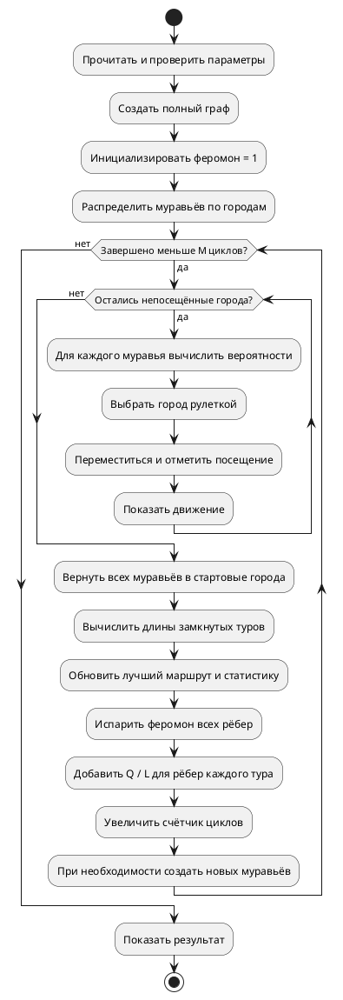
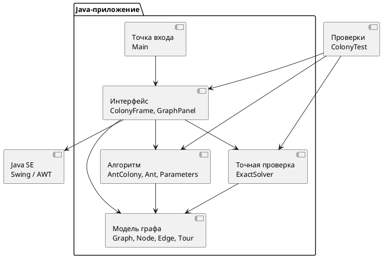
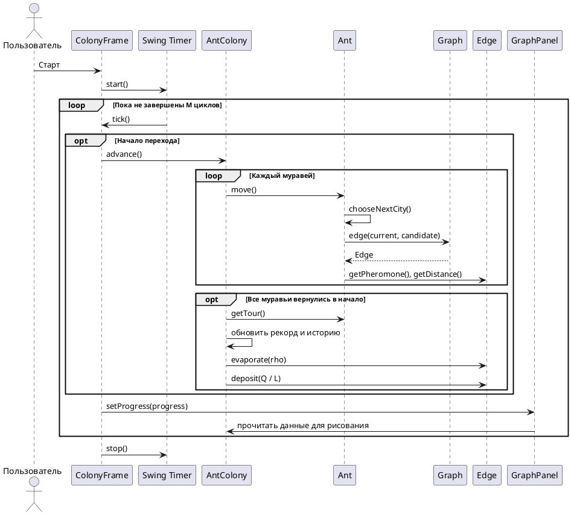
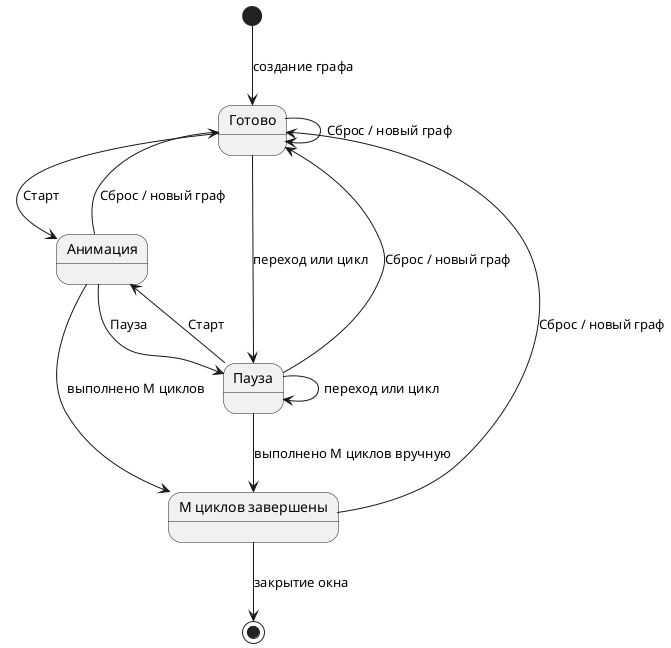
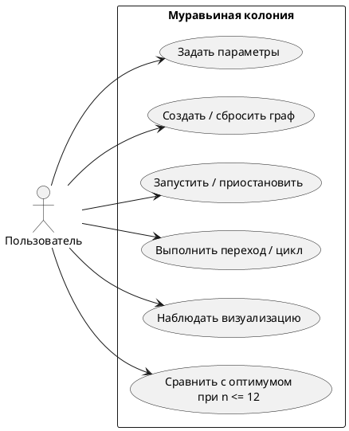
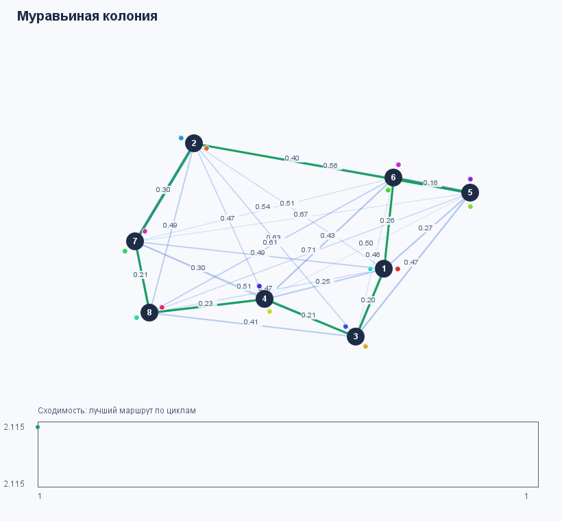
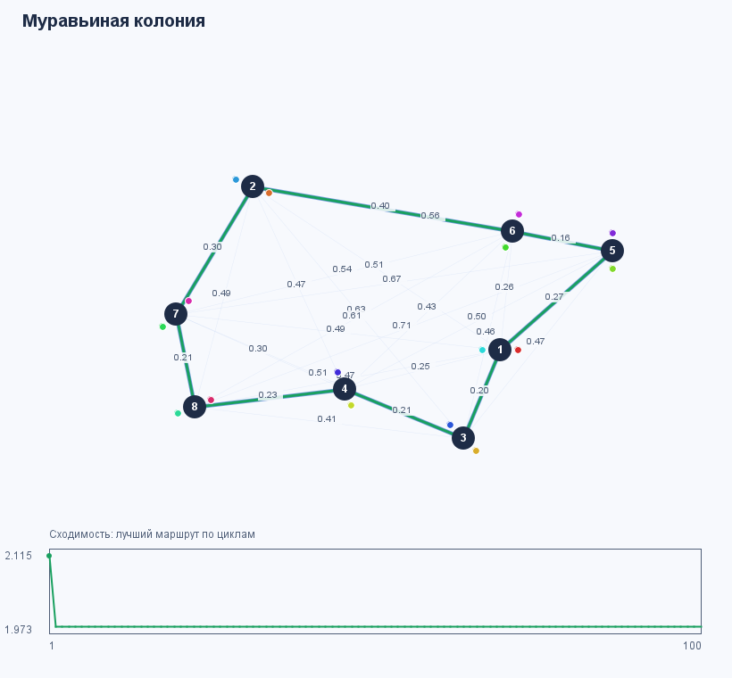

# Отчёт по лабораторной работе

**Дисциплина:** объектно-ориентированное программирование  
**Тема:** алгоритм муравьиной колонии для задачи коммивояжёра  
**Вуз:** ____________________  
**Выполнил:** ____________________  
**Группа:** ____________________  
**Проверил:** ____________________  
**Год:** 2026

## Цель работы

Реализовать на Java муравьиный алгоритм, разделить программу на классы предметной области и построить визуализацию движения муравьёв, изменения феромона и улучшения маршрута.

## Постановка задачи

Среда представляет полный неориентированный граф. Узлы соответствуют городам, рёбра имеют положительные евклидовы расстояния. Нужно посетить каждый город ровно один раз и вернуться в начало, минимизируя суммарную длину. Программа позволяет выбирать 3–30 городов, 1–500 муравьёв и 1–10000 циклов.

## Метод решения

Программа реализует Ant System. Каждый муравей хранит посещённые города. При выборе следующего города учитываются феромон τ и видимость η = 1/d:

```text
p(i,j) = τ(i,j)^α * η(i,j)^β / Σ[τ(i,k)^α * η(i,k)^β]
```

Знаменатель суммирует веса только непосещённых городов. Выбор выполняется методом рулетки, а не жадным выбором самого вероятного ребра. Веса рассчитываются через логарифмы с последующей нормализацией для численной устойчивости.

После возвращения всех муравьёв в начало вычисляются длины туров и обновляется лучший маршрут. Затем применяется испарение и отложение феромона:

```text
τ(i,j) = (1 - ρ) * τ(i,j) + Σ[k использует (i,j)] Q / L(k)
```

В PDF формулы обновления и обозначение ρ неоднозначны. В реализации ρ обозначает долю испарения, используется приведённая общая формула Ant System. Одно ребро общее для обоих направлений. Замыкающее ребро тоже получает феромон. Начальный уровень τ = 1, нижний предел 1e-12.

Стартовые города распределены максимально равномерно. При α = β = 0 все непосещённые города равновероятны. При β = 0 первый цикл тоже равномерный, поскольку начальный феромон одинаков. При β > 0 алгоритм с первого цикла чаще выбирает короткие рёбра.

Муравьиная оптимизация относится к роевым метаэвристикам. Генетический алгоритм обычно использует популяцию решений, отбор, скрещивание и мутацию. В Ant System связь между агентами осуществляется через феромон. Эти подходы стоит различать, хотя в методичке муравьиный алгоритм назван примером генетического.

## Объектная модель

`Node` хранит номер и координаты города. `Edge` инкапсулирует длину и изменяемый феромон. `Graph` создаёт и предоставляет граф. `Ant` отвечает за память посещений, выбор следующего города и движение. `Tour` проверяет и хранит неизменяемый замкнутый маршрут. `Parameters` проверяет параметры. `AntColony` координирует циклы и собирает статистику.

Интерфейс отделён от модели: `GraphPanel` рисует состояние, `ColonyFrame` обрабатывает действия пользователя, `Main` запускает окно в потоке Swing EDT. `ExactSolver` независимо вычисляет точный оптимум методом Held–Karp для n ≤ 12. Точное решение не используется при выборе маршрутов муравьёв.

Инкапсуляцию обеспечивают закрытые поля, публичные методы и защитные копии массивов маршрутов. Неизменяемые объекты `Node`, `Tour`, `Parameters` упрощают передачу состояния. Композиция связывает граф с узлами и рёбрами, колонию с муравьями. Наследование от `JFrame` и `JPanel` позволяет использовать полиморфные методы Swing, в частности `paintComponent`.

## UML-диаграммы

Шесть диаграмм приведены ниже в исходном формате PlantUML. Их можно отрендерить плагином PlantUML. Эти же исходники находятся в `docs/uml/`.

### activity



### classes

```plantuml
@startuml
skinparam classAttributeIconSize 0
class Main { +main(args: String[]): void }
class ColonyFrame {
  -colony: AntColony
  -optimum: Tour
  -reset(): void
  -tick(): void
  -refresh(): void
}
class GraphPanel {
  -colony: AntColony
  +setColony(colony): void
  #paintComponent(graphics): void
}
class Parameters {
  +ants: int
  +iterations: int
  +alpha: double
  +beta: double
  +rho: double
  +q: double
  +seed: long
}
class Graph {
  -nodes: List<Node>
  -edges: List<Edge>
  +random(count, seed): Graph
  +edge(a, b): Edge
  +resetPheromone(): void
}
class Node {
  -id: int
  -x: double
  -y: double
}
class Edge {
  -distance: double
  -pheromone: double
  +evaporate(rho): void
  +deposit(amount): void
}
class Ant {
  -visited: boolean[]
  -route: int[]
  -position: int
  +chooseNextCity(): int
  +move(): void
  +getTour(): Tour
}
class Tour {
  -cities: int[]
  -length: double
  +getLength(): double
}
class AntColony {
  -best: Tour
  -history: List<Double>
  -iteration: int
  +advance(): void
  +runIteration(): void
  -finishIteration(): void
}
class ExactSolver { +{static} solve(graph): Tour }
Main ..> ColonyFrame
ColonyFrame *-- GraphPanel
ColonyFrame --> AntColony
ColonyFrame ..> ExactSolver
GraphPanel --> AntColony
AntColony --> Graph
AntColony --> Parameters
AntColony *-- "1..*" Ant
AntColony o-- Tour
Graph *-- "3..*" Node
Graph *-- "3..*" Edge
Edge --> "2" Node
Ant --> Graph
Ant --> Parameters
Ant ..> Tour
ExactSolver ..> Graph
ExactSolver ..> Tour
@enduml

```

### components



### sequence



### states



### use-case



## Демонстрация визуализации

Для воспроизводимого примера использованы 8 городов, 16 муравьёв, 100 циклов, seed = 42, α = 1.5, β = 2, ρ = 0.35, Q = 1.

После первого завершённого цикла:



После ста циклов:



Изображения представляют рендер панели реальной модели из автоматической проверки. Для демонстрации движения нужно запустить `Main` и нажать «Старт». Синие рёбра отображают относительную интенсивность феромона, зелёные выделяют рекордный тур, цветные точки обозначают муравьёв. График внизу показывает изменение длины лучшего найденного маршрута.

## Проверка и результаты

Команда `./run.ps1 -Test` успешно проверяет:

- общий объект ребра для обоих направлений;
- известный оптимум единичного квадрата: 4;
- отсутствие обновления феромона до окончания всех туров;
- точное соответствие обновления формуле испарения и сумме вкладов;
- допустимость замкнутых туров и остановку после M циклов;
- монотонность рекорда и воспроизводимость по seed;
- равномерный выбор при α = β = 0 на 12000 испытаниях;
- совпадение Held–Karp с полным перебором для пяти графов из 7 городов;
- отрисовку визуализации в режиме без дисплея.

В воспроизводимом эксперименте длина лучшего маршрута составила **1.97319908** условных единиц. Независимое точное решение дало **1.97319908**. Отклонение равно **0%** с точностью вычислений.

Это результат конкретного эксперимента. Вероятностный алгоритм не гарантирует глобального оптимума за конечное число циклов. Сохранение положительного феромона оставляет возможность других маршрутов, поэтому не следует ожидать обязательного перехода абсолютно всех муравьёв на один тур. Интерфейс показывает фактическое количество совпадений длины с рекордом последнего цикла.

## Вывод

Реализовано приложение на Java с отдельными классами муравьёв, городов и путей. Муравьи строят допустимые замкнутые маршруты, обмениваются информацией через феромон и улучшают найденное решение. Визуализация позволяет наблюдать движение, концентрацию феромона и историю рекордов. Для учебных графов результат можно сравнить с точным решением.

## Приложение: исходный код Java

Код ниже соответствует реализации в каталоге `src` на момент подготовки отчёта.

### Ant.java

```java
import java.util.Arrays;
import java.util.Random;

/** Муравей хранит посещённые города и выбирает следующий переход методом рулетки. */
public final class Ant {
    private final Graph graph;
    private final Parameters parameters;
    private final Random random;
    private final boolean[] visited;
    private final int[] route;
    private int position;
    public Ant(Graph graph, Parameters parameters, Random random, int start) {
        this.graph = graph; this.parameters = parameters; this.random = random;
        visited = new boolean[graph.size()]; route = new int[graph.size()+1];
        route[0] = start; visited[start] = true;
    }
    public boolean isFinished() { return position == graph.size(); }
    public int getCurrentCity() { return route[position]; }
    public int[] getRoute() { return Arrays.copyOf(route, position+1); }
    public void move() {
        if (isFinished()) return;
        int next = position == graph.size()-1 ? route[0] : chooseNextCity();
        route[++position] = next; visited[next] = true;
    }
    public int chooseNextCity() {
        // Вычисление в логарифмах предотвращает переполнение tau^alpha * eta^beta.
        double[] weights = new double[graph.size()];
        double max = Double.NEGATIVE_INFINITY;
        for (int i = 0; i < weights.length; i++) {
            if (visited[i]) continue;
            Edge edge = graph.edge(getCurrentCity(), i);
            weights[i] = parameters.alpha * Math.log(edge.getPheromone())
                    - parameters.beta * Math.log(edge.getDistance());
            max = Math.max(max, weights[i]);
        }
        if (!Double.isFinite(max)) throw new IllegalStateException("Нет непосещённых городов");
        double sum = 0; int last = -1;
        for (int i = 0; i < weights.length; i++) if (!visited[i]) {
            weights[i] = Math.exp(weights[i] - max); sum += weights[i]; last = i;
        }
        double choice = random.nextDouble() * sum;
        for (int i = 0; i < weights.length; i++) if (!visited[i]) {
            choice -= weights[i]; if (choice < 0) return i;
        }
        return last;
    }
    public Tour getTour() {
        if (!isFinished()) throw new IllegalStateException("Маршрут ещё не завершён");
        return new Tour(graph, route);
    }
}

```

### AntColony.java

```java
import java.util.*;

/** Ant System: обновление феромона происходит после завершения ВСЕХ маршрутов. */
public final class AntColony {
    private final Graph graph;
    private final Parameters parameters;
    private final Random random;
    private final List<Ant> ants = new ArrayList<>();
    private final List<Double> history = new ArrayList<>();
    private Tour best;
    private double iterationBest, average;
    private int matchingBest, iteration, step;
    public AntColony(Graph graph, Parameters parameters) {
        this.graph = graph; this.parameters = parameters; random = new Random(parameters.seed);
        graph.resetPheromone(); startAnts();
    }
    private void startAnts() {
        ants.clear();
        for (int i = 0; i < parameters.ants; i++)
            ants.add(new Ant(graph, parameters, random, i % graph.size()));
    }
    /** Один переход каждого муравья, включая возврат в стартовый город. */
    public void advance() {
        if (isFinished()) return;
        if (step == graph.size()) { startAnts(); step = 0; }
        for (Ant ant : ants) ant.move();
        step++;
        if (step == graph.size()) finishIteration();
    }
    public void runIteration() {
        if (isFinished()) return;
        int target = iteration + 1;
        while (iteration < target) advance();
    }
    private void finishIteration() {
        List<Tour> tours = new ArrayList<>();
        iterationBest = Double.POSITIVE_INFINITY; average = 0;
        for (Ant ant : ants) {
            Tour tour = ant.getTour(); tours.add(tour); average += tour.getLength();
            iterationBest = Math.min(iterationBest, tour.getLength());
            if (best == null || tour.getLength() < best.getLength()) best = tour;
        }
        average /= ants.size(); matchingBest = 0;
        for (Tour tour : tours) if (Math.abs(tour.getLength() - best.getLength()) < 1e-9) matchingBest++;
        for (Edge edge : graph.getEdges()) edge.evaporate(parameters.rho);
        for (Tour tour : tours) {
            int[] cities = tour.getCities();
            for (int i = 1; i < cities.length; i++)
                graph.edge(cities[i-1], cities[i]).deposit(parameters.q / tour.getLength());
        }
        iteration++; history.add(best.getLength());
    }
    public Graph getGraph() { return graph; }
    public List<Ant> getAnts() { return Collections.unmodifiableList(ants); }
    public List<Double> getHistory() { return Collections.unmodifiableList(history); }
    public Tour getBest() { return best; }
    public int getIteration() { return iteration; }
    public int getStep() { return step; }
    public double getIterationBest() { return iterationBest; }
    public double getAverage() { return average; }
    public int getMatchingBest() { return matchingBest; }
    public boolean isFinished() { return iteration >= parameters.iterations; }
}

```

### ColonyFrame.java

```java
import javax.swing.*;
import javax.swing.border.EmptyBorder;
import java.awt.*;

/** Контроллер окна. Модель не зависит от Swing. */
public final class ColonyFrame extends JFrame {
    private final JSpinner cities = spinner(8, 3, 30, 1);
    private final JSpinner ants = spinner(32, 1, 500, 1);
    private final JSpinner iterations = spinner(200, 1, 10000, 10);
    private final JSpinner alpha = spinner(1.5, 0, 10, .1);
    private final JSpinner beta = spinner(2, 0, 10, .1);
    private final JSpinner rho = spinner(.35, .01, .99, .05);
    private final JSpinner q = spinner(1, .01, 10000, .1);
    private final JSpinner seed = spinner(42, 0, 1000000, 1);
    private final JSlider speed = new JSlider(1, 100, 65);
    private final JButton start = new JButton("Старт");
    private final JButton step = new JButton("Один переход");
    private final JButton cycle = new JButton("Один цикл");
    private final JLabel status = new JLabel(" ");
    private final JTextArea statistics = new JTextArea();
    private final GraphPanel canvas = new GraphPanel();
    private final Timer timer;
    private AntColony colony;
    private Tour optimum;
    private double progress = 1;

    public ColonyFrame() {
        super("Лабораторная работа: муравьиный алгоритм | Java ООП");
        setDefaultCloseOperation(EXIT_ON_CLOSE);
        setMinimumSize(new Dimension(1020, 720));
        JPanel controls = new JPanel(new GridLayout(0, 2, 8, 8));
        controls.setBorder(new EmptyBorder(16, 16, 12, 16));
        addControl(controls, "Города", cities); addControl(controls, "Муравьи", ants);
        addControl(controls, "Число циклов M", iterations);
        addControl(controls, "α: влияние феромона", alpha); addControl(controls, "β: влияние расстояния", beta);
        addControl(controls, "ρ: доля испарения", rho); addControl(controls, "Q: отложение феромона", q);
        addControl(controls, "Seed эксперимента", seed); addControl(controls, "Скорость", speed);
        JButton reset = new JButton("Сброс / применить");
        JButton newGraph = new JButton("Новый граф");
        controls.add(start); controls.add(step); controls.add(cycle); controls.add(reset);
        controls.add(newGraph);
        JCheckBox showBest = new JCheckBox("Лучший путь", true);
        showBest.addActionListener(e -> { canvas.setShowBest(showBest.isSelected()); });
        controls.add(showBest);
        statistics.setEditable(false); statistics.setLineWrap(true); statistics.setWrapStyleWord(true);
        statistics.setFont(new Font(Font.MONOSPACED, Font.PLAIN, 13));
        statistics.setBorder(new EmptyBorder(12, 16, 12, 16));
        JPanel sidebar = new JPanel(new BorderLayout()); sidebar.setPreferredSize(new Dimension(350, 650));
        sidebar.add(controls, BorderLayout.NORTH); sidebar.add(new JScrollPane(statistics), BorderLayout.CENTER);
        add(sidebar, BorderLayout.WEST); add(canvas, BorderLayout.CENTER);
        status.setBorder(new EmptyBorder(8, 16, 8, 16)); add(status, BorderLayout.SOUTH);
        timer = new Timer(25, e -> tick());
        start.addActionListener(e -> {
            if (timer.isRunning()) pause();
            else if (!colony.isFinished()) { timer.start(); start.setText("Пауза"); updateButtons(); }
        });
        step.addActionListener(e -> { advance(); progress = 1; canvas.setProgress(1); refresh(); });
        cycle.addActionListener(e -> { colony.runIteration(); canvas.clearAnimation(); refresh(); });
        reset.addActionListener(e -> reset());
        newGraph.addActionListener(e -> {
            seed.setValue((((Number) seed.getValue()).intValue() + 1) % 1000001); reset();
        });
        reset(); setSize(1180, 800); setLocationRelativeTo(null);
    }
    private static JSpinner spinner(double value, double min, double max, double increment) {
        return new JSpinner(new SpinnerNumberModel(value, min, max, increment));
    }
    private void addControl(JPanel panel, String label, JComponent input) {
        panel.add(new JLabel(label)); panel.add(input);
    }
    private double value(JSpinner spinner) { return ((Number) spinner.getValue()).doubleValue(); }
    private void reset() {
        pause();
        try {
            for (JSpinner input : new JSpinner[]{cities, ants, iterations, alpha, beta, rho, q, seed}) input.commitEdit();
            Parameters parameters = new Parameters((int)value(ants), (int)value(iterations), value(alpha), value(beta),
                    value(rho), value(q), (long)value(seed));
            Graph graph = Graph.random((int)value(cities), parameters.seed);
            colony = new AntColony(graph, parameters);
            optimum = graph.size() <= 12 ? ExactSolver.solve(graph) : null;
            canvas.setColony(colony); progress = 1; refresh();
        } catch (Exception ex) {
            JOptionPane.showMessageDialog(this, "Проверьте параметры: " + ex.getMessage(), "Ошибка ввода", JOptionPane.ERROR_MESSAGE);
        }
    }
    private void pause() { timer.stop(); start.setText("Старт"); if (colony != null) updateButtons(); }
    private void advance() {
        int[] from = new int[colony.getAnts().size()];
        // После завершения цикла муравьи вновь распределяются по стартовым городам.
        for (int i = 0; i < from.length; i++) from[i] = colony.getAnts().get(i).getCurrentCity();
        colony.advance(); canvas.animateFrom(from); progress = 0;
    }
    private void tick() {
        if (progress >= 1) {
            if (colony.isFinished()) { pause(); refresh(); return; }
            advance();
        }
        progress = Math.min(1, progress + .015 + speed.getValue() * .004);
        canvas.setProgress(progress); refresh();
    }
    private void updateButtons() {
        start.setEnabled(!colony.isFinished());
        step.setEnabled(!timer.isRunning() && !colony.isFinished());
        cycle.setEnabled(!timer.isRunning() && !colony.isFinished());
    }
    private void refresh() {
        updateButtons();
        Tour best = colony.getBest();
        String text = "Цикл: " + colony.getIteration() + "\nПереход: " + colony.getStep() + " / " + colony.getGraph().size();
        if (best != null) {
            text += String.format(java.util.Locale.US,
                    "\n\nЛучший за всё время: %.5f\nЛучший в цикле: %.5f\nСредний в цикле: %.5f\nСовпали с рекордом: %d / %d\n\nМаршрут:\n%s",
                    best.getLength(), colony.getIterationBest(), colony.getAverage(), colony.getMatchingBest(), colony.getAnts().size(), best);
        }
        if (optimum != null) {
            text += String.format(java.util.Locale.US, "\n\nТочный оптимум: %.5f", optimum.getLength());
            if (best != null) text += String.format(java.util.Locale.US, "\nОтклонение: %.2f %%",
                    Math.max(0, 100 * (best.getLength() / optimum.getLength() - 1)));
        } else text += "\n\nТочный расчёт доступен до 12 городов.";
        text += "\n\nСиний: феромон (толще = больше).\nЗелёный: лучший найденный тур.\nЦветные точки: муравьи.\nЧисла на рёбрах: расстояния (n ≤ 10).\n\nИзменения параметров применяются кнопкой «Сброс / применить».";
        statistics.setText(text);
        status.setText(colony.isFinished() ? "Завершено M циклов. Для нового запуска нажмите «Сброс / применить»."
                : "Задача коммивояжёра: каждый город один раз и возврат в начало. Длины в условных единицах.");
        canvas.repaint();
    }
}

```

### Edge.java

```java
/** Одно общее ребро для обоих направлений движения. */
public final class Edge {
    private final Node from, to;
    private final double distance;
    private double pheromone = 1;
    public Edge(Node from, Node to) {
        this.from = from; this.to = to;
        distance = Math.hypot(from.getX() - to.getX(), from.getY() - to.getY());
        if (distance <= 0 || !Double.isFinite(distance))
            throw new IllegalArgumentException("Координаты городов должны различаться");
    }
    public Node getFrom() { return from; }
    public Node getTo() { return to; }
    public double getDistance() { return distance; }
    public double getPheromone() { return pheromone; }
    public void reset() { pheromone = 1; }
    public void evaporate(double rho) { pheromone = Math.max(1e-12, pheromone * (1 - rho)); }
    public void deposit(double amount) { pheromone += amount; }
}

```

### ExactSolver.java

```java
import java.util.Arrays;

/** Точный алгоритм Held-Karp для проверки на графах до 12 городов. */
public final class ExactSolver {
    private ExactSolver() { }
    public static Tour solve(Graph graph) {
        int n = graph.size();
        if (n > 12) throw new IllegalArgumentException("Точный расчёт: максимум 12 городов");
        int states = 1 << n;
        double[][] dp = new double[states][n];
        int[][] parent = new int[states][n];
        for (double[] row : dp) Arrays.fill(row, Double.POSITIVE_INFINITY);
        dp[1][0] = 0;
        for (int mask = 1; mask < states; mask += 2)
            for (int last = 0; last < n; last++) {
                if (!Double.isFinite(dp[mask][last])) continue;
                for (int next = 1; next < n; next++) {
                    if ((mask & (1 << next)) != 0) continue;
                    int newMask = mask | (1 << next);
                    double value = dp[mask][last] + graph.edge(last, next).getDistance();
                    if (value < dp[newMask][next]) {
                        dp[newMask][next] = value; parent[newMask][next] = last;
                    }
                }
            }
        int last = 1;
        for (int i = 2; i < n; i++)
            if (dp[states-1][i] + graph.edge(i, 0).getDistance()
                    < dp[states-1][last] + graph.edge(last, 0).getDistance()) last = i;
        int mask = states-1;
        int[] route = new int[n+1];
        for (int position = n-1; position > 0; position--) {
            route[position] = last;
            int previous = parent[mask][last]; mask ^= 1 << last; last = previous;
        }
        return new Tour(graph, route);
    }
}

```

### Graph.java

```java
import java.util.*;

/** Полный неориентированный взвешенный граф. */
public final class Graph {
    private final List<Node> nodes;
    private final List<Edge> edges = new ArrayList<>();
    private final Edge[][] adjacency;
    public Graph(List<Node> nodes) {
        if (nodes == null || nodes.size() < 3) throw new IllegalArgumentException("Нужно минимум 3 города");
        this.nodes = Collections.unmodifiableList(new ArrayList<>(nodes));
        adjacency = new Edge[nodes.size()][nodes.size()];
        for (int i = 0; i < nodes.size(); i++) {
            if (nodes.get(i).getId() != i) throw new IllegalArgumentException("Номера городов: 0, 1, ...");
            for (int j = 0; j < i; j++) {
                Edge edge = new Edge(nodes.get(i), nodes.get(j));
                adjacency[i][j] = adjacency[j][i] = edge;
                edges.add(edge);
            }
        }
    }
    public static Graph random(int count, long seed) {
        if (count < 3 || count > 30) throw new IllegalArgumentException("Число городов: 3..30");
        Random random = new Random(seed);
        List<Node> nodes = new ArrayList<>();
        while (nodes.size() < count) {
            double x = .06 + .88 * random.nextDouble(), y = .06 + .88 * random.nextDouble();
            boolean free = true;
            for (Node node : nodes)
                if (Math.hypot(x - node.getX(), y - node.getY()) < .065) free = false;
            if (free) nodes.add(new Node(nodes.size(), x, y));
        }
        return new Graph(nodes);
    }
    public int size() { return nodes.size(); }
    public List<Node> getNodes() { return nodes; }
    public List<Edge> getEdges() { return Collections.unmodifiableList(edges); }
    public Edge edge(int a, int b) { return adjacency[a][b]; }
    public void resetPheromone() { for (Edge edge : edges) edge.reset(); }
}

```

### GraphPanel.java

```java
import javax.swing.JPanel;
import java.awt.*;
import java.awt.geom.Line2D;
import java.util.List;

/** Визуализация читает модель и не влияет на выбор маршрутов. */
public final class GraphPanel extends JPanel {
    private AntColony colony;
    private boolean showBest = true;
    private int[] from;
    private double progress = 1;
    public GraphPanel() { setBackground(new Color(247, 249, 253)); }
    public void setColony(AntColony colony) { this.colony = colony; clearAnimation(); }
    public void setShowBest(boolean show) { showBest = show; repaint(); }
    public void animateFrom(int[] from) { this.from = from.clone(); }
    public void setProgress(double progress) { this.progress = progress; repaint(); }
    public void clearAnimation() { from = null; progress = 1; repaint(); }
    private int x(Node node) { return 35 + (int)(node.getX() * (getWidth()-70)); }
    private int y(Node node) { return 55 + (int)(node.getY() * (getHeight()-250)); }
    @Override protected void paintComponent(Graphics graphics) {
        super.paintComponent(graphics);
        if (colony == null) return;
        Graphics2D g = (Graphics2D) graphics.create();
        g.setRenderingHint(RenderingHints.KEY_ANTIALIASING, RenderingHints.VALUE_ANTIALIAS_ON);
        g.setFont(new Font(Font.SANS_SERIF, Font.BOLD, 19));
        g.setColor(new Color(30, 44, 70)); g.drawString("Муравьиная колония", 25, 30);
        Graph graph = colony.getGraph();
        double max = graph.getEdges().stream().mapToDouble(Edge::getPheromone).max().orElse(1);
        for (Edge edge : graph.getEdges()) {
            double strength = edge.getPheromone() / max;
            g.setColor(new Color(55, 110, 210, 25 + (int)(150 * strength)));
            g.setStroke(new BasicStroke((float)(.5 + 4 * strength)));
            g.draw(new Line2D.Double(x(edge.getFrom()), y(edge.getFrom()), x(edge.getTo()), y(edge.getTo())));
        }
        if (showBest && colony.getBest() != null) {
            g.setColor(new Color(25, 160, 95)); g.setStroke(new BasicStroke(3));
            int[] route = colony.getBest().getCities();
            for (int i = 1; i < route.length; i++) {
                Node a = graph.getNodes().get(route[i-1]), b = graph.getNodes().get(route[i]);
                g.drawLine(x(a), y(a), x(b), y(b));
            }
        }
        if (graph.size() <= 10) {
            g.setFont(new Font(Font.SANS_SERIF, Font.PLAIN, 10));
            for (Edge edge : graph.getEdges()) {
                int mx = (x(edge.getFrom()) + x(edge.getTo())) / 2;
                int my = (y(edge.getFrom()) + y(edge.getTo())) / 2;
                String label = String.format(java.util.Locale.US, "%.2f", edge.getDistance());
                g.setColor(new Color(247, 249, 253, 220)); g.fillRect(mx-13, my-9, 28, 12);
                g.setColor(new Color(80, 95, 120)); g.drawString(label, mx-12, my);
            }
        }
        for (Node node : graph.getNodes()) {
            g.setColor(new Color(30, 44, 70)); g.fillOval(x(node)-13, y(node)-13, 26, 26);
            g.setColor(Color.WHITE); g.setFont(new Font(Font.SANS_SERIF, Font.BOLD, 12));
            String label = String.valueOf(node.getId()+1);
            g.drawString(label, x(node)-g.getFontMetrics().stringWidth(label)/2, y(node)+4);
        }
        for (int i = 0; i < colony.getAnts().size(); i++) {
            Node target = graph.getNodes().get(colony.getAnts().get(i).getCurrentCity());
            Node source = from == null ? target : graph.getNodes().get(from[i]);
            double angle = 2 * Math.PI * i / colony.getAnts().size();
            int ax = (int)(x(source) + progress * (x(target)-x(source)) + 20*Math.cos(angle));
            int ay = (int)(y(source) + progress * (y(target)-y(source)) + 20*Math.sin(angle));
            g.setColor(Color.getHSBColor(i / (float)colony.getAnts().size(), .8f, .85f));
            g.fillOval(ax-4, ay-4, 8, 8); g.setColor(Color.WHITE); g.setStroke(new BasicStroke(1));
            g.drawOval(ax-4, ay-4, 8, 8);
        }
        drawHistory(g); g.dispose();
    }
    private void drawHistory(Graphics2D g) {
        int left = 55, top = getHeight()-145, width = getWidth()-90, height = 95;
        g.setColor(new Color(80, 95, 120)); g.setFont(new Font(Font.SANS_SERIF, Font.PLAIN, 12));
        g.drawString("Сходимость: лучший маршрут по циклам", left, top-12);
        g.setStroke(new BasicStroke(1)); g.drawRect(left, top, width, height);
        List<Double> history = colony.getHistory();
        if (history.isEmpty()) { g.drawString("Ожидание первого завершённого цикла", left+12, top+35); return; }
        double min = history.stream().mapToDouble(Double::doubleValue).min().getAsDouble();
        double max = history.get(0), range = Math.max(.01, max-min);
        g.drawString(String.format(java.util.Locale.US, "%.3f", max), 5, top+12);
        g.drawString(String.format(java.util.Locale.US, "%.3f", min), 5, top+height);
        g.setColor(new Color(25, 160, 95)); g.setStroke(new BasicStroke(2));
        for (int i = 0; i < history.size(); i++) {
            int px = left + i*width/Math.max(1, history.size()-1);
            int py = top+8 + (int)((max-history.get(i))/range * (height-16));
            if (i == 0) g.fillOval(px-3, py-3, 6, 6);
            else {
                int previousY = top+8+(int)((max-history.get(i-1))/range*(height-16));
                g.drawLine(left+(i-1)*width/Math.max(1, history.size()-1), previousY, px, py);
            }
        }
        g.setColor(new Color(80, 95, 120)); g.drawString("1", left, top+height+18);
        g.drawString(String.valueOf(history.size()), left+width-20, top+height+18);
    }
}

```

### Main.java

```java
import javax.swing.SwingUtilities;
import javax.swing.UIManager;

public class Main {
    public static void main(String[] args) {
        SwingUtilities.invokeLater(() -> {
            try { UIManager.setLookAndFeel(UIManager.getSystemLookAndFeelClassName()); }
            catch (Exception ignored) { /* Используем стандартную тему Swing. */ }
            new ColonyFrame().setVisible(true);
        });
    }
}

```

### Node.java

```java
/** Неизменяемый город. Координаты задают евклидовы расстояния. */
public final class Node {
    private final int id;
    private final double x, y;
    public Node(int id, double x, double y) {
        if (id < 0 || !Double.isFinite(x) || !Double.isFinite(y))
            throw new IllegalArgumentException("Некорректный город");
        this.id = id; this.x = x; this.y = y;
    }
    public int getId() { return id; }
    public double getX() { return x; }
    public double getY() { return y; }
}

```

### Parameters.java

```java
/** rho - доля испарения; Q - количество откладываемого феромона. */
public final class Parameters {
    public final int ants, iterations;
    public final double alpha, beta, rho, q;
    public final long seed;
    public Parameters(int ants, int iterations, double alpha, double beta, double rho, double q, long seed) {
        if (ants < 1 || ants > 500 || iterations < 1 || iterations > 10000
                || !Double.isFinite(alpha) || alpha < 0 || alpha > 10
                || !Double.isFinite(beta) || beta < 0 || beta > 10
                || !Double.isFinite(rho) || rho <= 0 || rho >= 1
                || !Double.isFinite(q) || q <= 0 || q > 10000)
            throw new IllegalArgumentException("Недопустимые параметры");
        this.ants = ants; this.iterations = iterations;
        this.alpha = alpha; this.beta = beta; this.rho = rho; this.q = q; this.seed = seed;
    }
}

```

### Tour.java

```java
import java.util.Arrays;

/** Замкнутый маршрут: последняя вершина повторяет первую. */
public final class Tour {
    private final int[] cities;
    private final double length;
    public Tour(Graph graph, int[] cities) {
        if (cities.length != graph.size() + 1 || cities[0] != cities[cities.length - 1])
            throw new IllegalArgumentException("Маршрут должен быть замкнутым");
        boolean[] visited = new boolean[graph.size()];
        for (int i = 0; i < graph.size(); i++) {
            int city = cities[i];
            if (city < 0 || city >= graph.size() || visited[city])
                throw new IllegalArgumentException("Каждый город посещается один раз");
            visited[city] = true;
        }
        double sum = 0;
        for (int i = 1; i < cities.length; i++) sum += graph.edge(cities[i - 1], cities[i]).getDistance();
        this.cities = cities.clone(); length = sum;
    }
    public int[] getCities() { return cities.clone(); }
    public double getLength() { return length; }
    public boolean contains(Edge edge) {
        int a = edge.getFrom().getId(), b = edge.getTo().getId();
        for (int i = 1; i < cities.length; i++)
            if ((cities[i-1] == a && cities[i] == b) || (cities[i-1] == b && cities[i] == a)) return true;
        return false;
    }
    @Override public String toString() {
        return Arrays.toString(Arrays.stream(cities).map(i -> i + 1).toArray());
    }
}

```
